# binrec

Record everything a command reads and writes.

`binrec` puts a small shim in front of any binary on your `PATH`. Every time the binary runs, the shim passes stdin, stdout and stderr straight through to the real program and writes the whole session (arguments, every chunk of input and output, and the exit code) to an [ndjson](https://github.com/ndjson/ndjson-spec) file. You can use it from the command line or as a library, for example to check in tests exactly how your code called a tool.

Requires [Bun](https://bun.sh).

## Install

```sh
bun add -g @jondotsoy/binrec   # the binrec CLI
bun add @jondotsoy/binrec      # the library
```

## CLI

Create the shim folder (`~/.binrec/bin`) and see how to add it to your `PATH`:

```sh
binrec install
```

Install a shim for a binary:

```sh
binrec install date
```

`binrec` resolves the real path (for example `/usr/bin/date`) and writes an executable `~/.binrec/bin/date` that runs `binrec rec /usr/bin/date "$@"`.

For the shim to take over, its folder must come **before** the real binary in `PATH`:

```sh
export PATH="$HOME/.binrec/bin:$PATH"
```

From then on every `date` call is recorded in `~/.binrec/records/<sessionId>.ndjson`, and `date` behaves exactly as before: same output, same exit code.

You can also record a single run without installing a shim:

```sh
binrec rec /usr/bin/date +%F
binrec rec --records ./records /usr/bin/date +%F
```

| Command | What it does |
| --- | --- |
| `binrec install` | Creates the shim folder and prints the `PATH` line for `~/.bashrc`. |
| `binrec install <bin>` | Installs a shim for `<bin>`. |
| `binrec uninstall <bin>` | Removes the shim for `<bin>`. Its recorded sessions are kept. |
| `binrec uninstall --all` | Removes every shim in the shim folder. Recorded sessions are kept. |
| `binrec on` / `binrec off` | Turns recording on or off for every shim without removing them (aliases: `enable` / `disable`). Shims keep working while recording is off. |
| `binrec on <bin>` / `binrec off <bin>` | Same as `binrec install <bin>` / `binrec uninstall <bin>` (`off --all` works too). |
| `binrec stats` | Shows how many sessions were recorded, how many bytes they consumed in total, and a ranking of the commands that consumed the most. |
| `binrec list [<bin>]` | Lists the recorded sessions, oldest first, with their id, start time, exit code, size and command line. With `<bin>`, only the sessions of that binary. |
| `binrec play [--timestamps] [--no-wait \| --speed <n>] <id>` | Plays session `<id>` back: writes its `stdout` and `stderr` again, each chunk as long after the start as it was recorded. The start of an id is enough when it matches only one session. `--timestamps` (`-t`) shows every line with its recorded timestamp, the time since the start and its stream. `--no-wait` (`-n`) writes the whole output at once, to see how the session ended. `--speed 2` plays twice as fast, `--speed 0.5` half as fast, and `--speed 0` is the same as `--no-wait`. |
| `binrec rec [--records <dir>] [--config <file>] <path> [args…]` | Runs `<path>`, passes stdio through, records the session and exits with its exit code. |
| `binrec --version` (`-v`) | Prints the binrec version. |
| `binrec --help` (`-h`) | Prints every command. `binrec <command> --help` (or `-h`) prints the help of one command without running it. For `rec`, only a lone `binrec rec --help` does; with more arguments, `--help` goes to the recorded program. |

Every session writes its size to its own `~/.binrec/records/<sessionId>.stats.json`, and `binrec stats` adds up those small files instead of reading every record:

```console
$ binrec stats
Sessions: 3
Consumed: 17.4 KB (17825 bytes)

Commands that consumed the most:
  1. /usr/bin/cat   17.4 KB  2 sessions
  2. /usr/bin/date     29 B  1 session
```

Set `BINREC_HOME` to use a folder other than `~/.binrec`.

Settings are saved in `~/.binrec/config.json`. For now it holds one setting, written by `binrec on` / `binrec off`:

```json
{ "recording": false }
```

`~/.binrec` contains:

| Path | What it holds |
| --- | --- |
| `bin/` | The shims. Each one points at the real binary, the records folder and `config.json`. |
| `records/` | One `<sessionId>.ndjson` file per recorded session, and its `<sessionId>.stats.json`. |
| `records/<sessionId>.stats.json` | `{ sessionId, command, total }` of one finished session, written when it ends. `binrec stats` writes it for older records that do not have one; a stats file whose record was deleted is not counted. |
| `config.json` | binrec's settings. A missing file means the defaults (recording on). |

### Playing a session back

`binrec list` shows the id of every recorded session; `binrec play` takes one of them, or just its start:

```console
$ binrec list
ID                                    STARTED               EXIT  SIZE  COMMAND
e531b87f-3f0c-4b7e-9a51-2c8d0f6a4e21  2026-10-18T16:31:43Z     0  50 B  /usr/bin/sh -c 'echo "building..."; sleep 1.2; echo "warning: unused variable" >&2; sleep 0.8; echo "done in 2.0s"'
```

`binrec play <id>` writes the session's `stdout` and `stderr` again with the recorded timing, so it looks just like the original run (stderr in red here):



`--timestamps` (`-t`) shows when each line was written: its recorded timestamp, the time since the session started and its stream, with the command line first and the exit code last:



```console
$ binrec play -t e531b87f
2026-10-18T16:31:43.597Z    +0.000s  $       /usr/bin/sh -c 'echo "building..."; sleep 1.2; echo "warning: unused variable" >&2; sleep 0.8; echo "done in 2.0s"'
2026-10-18T16:31:43.602Z    +0.005s  stdout  building...
2026-10-18T16:31:44.800Z    +1.202s  stderr  warning: unused variable
2026-10-18T16:31:45.602Z    +2.004s  stdout  done in 2.0s
2026-10-18T16:31:45.603Z    +2.004s  exit    0
```

To skip the waits or change the pace:

```sh
binrec play --no-wait e531b87f    # the whole output at once, to see how the session ended (also: -n)
binrec play --speed 4 e531b87f    # four times faster
binrec play --speed 0.5 e531b87f  # half as fast
binrec play -t -n e531b87f        # every line with its timestamp, without waiting
```

`play` keeps each stream on its own: `binrec play <id> 2>/dev/null` shows only what went to `stdout`. It does not write the `stdin` chunks back: on a terminal, what you typed is already in `stdout` as the terminal's echo.

The animations above are made from a real record with `bun scripts/demo-svg.ts <record.ndjson> docs/play.svg [--timestamps]`.

## Record format

Each session is one ndjson file:

```ndjson
{"type":"command","sessionId":"8969d708-…","timestamp":"2026-10-18T04:05:14.936Z","performance":9.05,"command":"/usr/bin/date","args":["+%F"],"pid":48213}
{"type":"stdout","timestamp":"2026-10-18T04:05:14.949Z","performance":22.70,"size":11,"data":"2026-10-18\n"}
{"type":"end","timestamp":"2026-10-18T04:05:14.950Z","performance":23.68,"exitCode":0,"total":11}
```

- The first line (`command`) has the session id, the absolute path of the binary, its arguments and `pid`, the process id of the recorded program.
- Each `stdin`, `stdout` and `stderr` line holds one chunk as text in `data`, and its length in bytes in `size` (the bytes the program read or wrote, not the length of the text or base64).
- If a chunk is not valid UTF-8 on its own, `data` is `null` and the raw bytes are in `data_base64`, so nothing is lost.
- On a terminal, `resize` lines hold the window size (`cols`, `rows`): one at the start and one each time the window changes.
- If binrec gets `SIGTERM` or `SIGHUP` (a `kill`, a closed terminal), it passes the signal on to the program, so it never keeps running on its own, and records a `signal` line. `SIGINT` and `SIGQUIT` are recorded too; on a terminal binrec passes them on, and with pipes the program already gets them from the terminal. Either way the session still ends with its `end` line.
- The last line (`end`) has the exit code and `total`, the sum of every chunk's `size`.
- Records are private: each file is created with mode `0600` and a records folder binrec creates gets `0700`, so only the user who recorded a session can read it, whatever the `umask`.
- `timestamp` is wall-clock time (ISO 8601) and `performance` is `performance.now()` in the recording process.

## Library

```ts
import { $ } from "bun";
import { binrec } from "@jondotsoy/binrec";

const b = binrec.create({ path: "/tmp/my-bin" }); // path and records are optional
await b.install("date");

await $`date +%F`.env({ ...process.env, PATH: `${b.path}:${process.env.PATH}` });

const session = await b.lastSession("date");
session?.args;     // ["+%F"]
session?.exitCode; // 0
session?.lines;    // every ndjson line of the session
```

| API | Description |
| --- | --- |
| `binrec.create({ path?, records? })` | Creates an instance. `path` is the shim folder (default `~/.binrec/bin`), `records` the records folder (default `records` next to `path`). |
| `b.path`, `b.records`, `b.config` | Absolute paths of the shim folder, the records folder and `config.json`. |
| `b.init()` | Creates the shim folder. |
| `b.install(command)` | Installs a shim for `command` and returns its path. Throws if the command is not found. |
| `b.uninstall(command)` | Removes the shim for `command` and returns its path, or `null` if there was none. Only removes files binrec wrote; records are kept. |
| `b.uninstallAll()` | Removes every binrec shim in the shim folder and returns their paths. Other files are left alone. |
| `b.sessions(command?)` | Every recorded session of `command`, or of every command when it is left out, oldest first. `command` can be a name (`date`) or an absolute path. |
| `b.session(id)` | The session whose id is `id` or starts with `id`, or `null`. Throws when the start matches more than one session. |
| `b.play(id, { speed?, timestamps?, stdout?, stderr? })` | Writes the `stdout` and `stderr` of session `id` again with the recorded timing, like `binrec play`. Throws if there is no such session. |
| `b.lastSession(command)` | The most recent session of `command`, or `null`. |
| `b.stats()` | `{ sessions, total, commands }` from the sessions' stats files: the number of sessions, the bytes they consumed, and one `{ command, sessions, total }` per binary, the one that consumed the most first. A record without a stats file is read instead; records without `size` or `total` (older or unfinished ones) are counted from their data. |
| `b.disableRecords()` / `b.enableRecords()` | Turns recording off or on in `config.json`, for every shim installed by this instance. Shims keep working while recording is off. |
| `b.on()` / `b.off()` | Aliases of `b.enableRecords()` / `b.disableRecords()`. |
| `b.on(command)` / `b.off(command)` | Aliases of `b.install(command)` / `b.uninstall(command)`. |
| `b.isRecording()` | `true` unless recording was turned off. |
| `binrec.rec(path, args, { records })` | Runs and records one command, like `binrec rec`. Pass `records: false` to run without recording. |
| `play(session, { speed?, timestamps?, stdout?, stderr? })` | Plays a `Session` you already read back to `stdout` and `stderr` (default `process.stdout` and `process.stderr`). |

Each session has `sessionId`, `command`, `args`, `timestamp`, `exitCode` (`null` if it has not ended), `total` (bytes consumed), `recordPath` and `lines`.

## Notes

- When you run it on a terminal, binrec gives the program its own pseudo terminal, so interactive programs such as `vim`, `less` or `docker exec -it` work while they are recorded. Every key you type is recorded as `stdin` and everything the program draws as `stdout` (a terminal mixes stdout and stderr, so there are no `stderr` lines in that case).
- When stdin or stdout is not a terminal (pipes, redirects, CI), binrec uses pipes and keeps stdout and stderr apart.
- Shims are bash scripts and point at the Bun runtime and the binrec script that installed them.

## Development

```sh
bun install
bun test           # tests use Bun.$ and snapshots; the date cases need GNU date
bun run typecheck  # tsc --noEmit over the sources and tests
bun run build      # writes dist/binrec.js, dist/binrec.d.ts and dist/package.json
```

`dist/binrec.js` is both the library and the `binrec` bin; `dist/binrec.d.ts` holds its types. Only `dist/` is published; the root `package.json` is private.

Releases run from the **publish** GitHub Actions workflow (`workflow_dispatch`, with a `patch`, `minor` or `major` bump). It runs the tests, builds, publishes `dist/` to npm with trusted publishing (OIDC), tags the version and creates a GitHub release.

## Security

Records can contain secrets. See [SECURITY.md](SECURITY.md) for how records are protected and how to report a vulnerability.

## License

[MIT](LICENSE) © [Jonathan Delgado](https://jon.soy) <hi@jon.soy>
