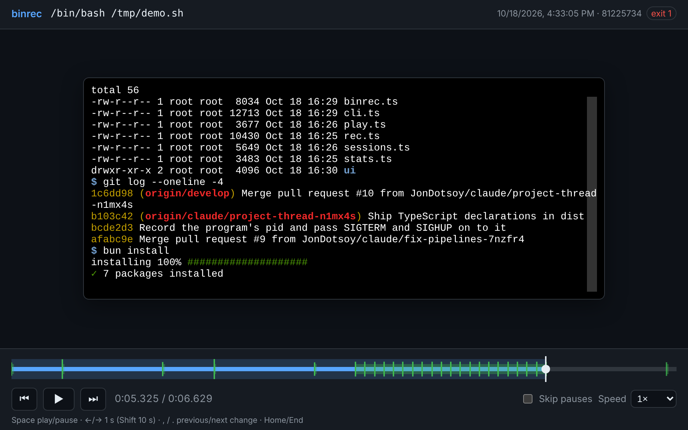
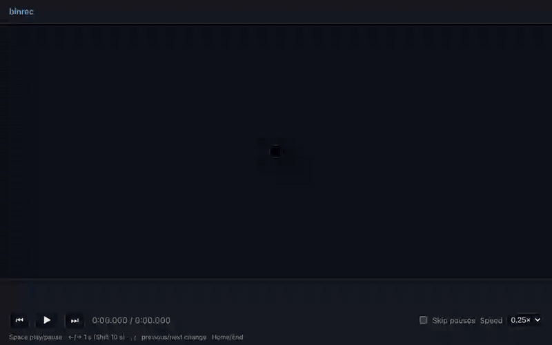
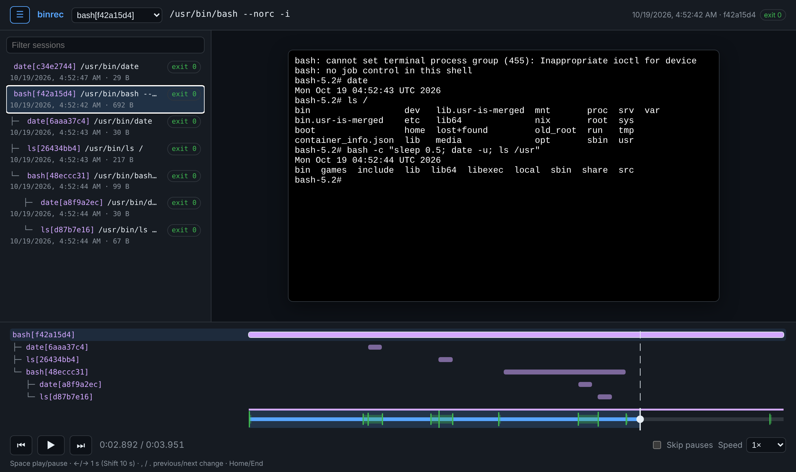

# binrec

Record everything a command reads and writes.

`binrec` puts a small shim in front of any binary on your `PATH`. Every time the binary runs, the shim passes stdin, stdout and stderr straight through to the real program and writes the whole session (arguments, every chunk of input and output, and the exit code) to an [ndjson](https://github.com/ndjson/ndjson-spec) file. You can use it from the command line or as a library, for example to check in tests exactly how your code called a tool.

Requires [Bun](https://bun.sh).

## Install

```sh
bun add -g @jondotsoy/binrec   # the binrec CLI
bun add @jondotsoy/binrec      # the library
```

## CLI

Create the shim folder (`~/.binrec/bin`) and see the lines to add to `~/.bashrc` so it comes first in your `PATH`:

```sh
binrec init
```

You can also run it directly, without installing binrec first:

```sh
bunx @jondotsoy/binrec init
```

`binrec init` does not change any file: copy the `export` lines it prints into `~/.bashrc` (or your shell's startup file) and reload it with `source ~/.bashrc`. When `BINREC_HOME` is not the default `~/.binrec`, it prints an `export BINREC_HOME=…` line too. `binrec install` without a binary does the same.

Install a shim for a binary:

```sh
binrec install date
```

`binrec` resolves the real path (for example `/usr/bin/date`) and writes an executable `~/.binrec/bin/date` that runs `binrec rec /usr/bin/date "$@"`.

For the shim to take over, its folder must come **before** the real binary in `PATH` (this is the line `binrec init` adds):

```sh
export PATH="$HOME/.binrec/bin:$PATH"
```

From then on every `date` call is recorded in `~/.binrec/records/<sessionId>.ndjson`, and `date` behaves exactly as before: same output, same exit code.

You can also record a single run without installing a shim:

```sh
binrec rec /usr/bin/date +%F
binrec rec --records ./records /usr/bin/date +%F
```

See [Recording one run](#recording-one-run-binrec-rec) for what `binrec rec` does before recording and the environment variables the program gets.

| Command | What it does |
| --- | --- |
| `binrec init` | Creates the shim folder and prints the `export` lines to add to `~/.bashrc`: `PATH` with the shim folder first, and `BINREC_HOME` when it is not the default. It does not change any file. `binrec install` without a binary is the same. |
| `binrec install <bin>` | Installs a shim for `<bin>`. |
| `binrec uninstall <bin>` | Removes the shim for `<bin>`. Its recorded sessions are kept. |
| `binrec uninstall --all` | Removes every shim in the shim folder. Recorded sessions are kept. |
| `binrec on` / `binrec off` | Turns recording on or off for every shim without removing them (aliases: `enable` / `disable`). Shims keep working while recording is off. |
| `binrec on <bin>` / `binrec off <bin>` | Same as `binrec install <bin>` / `binrec uninstall <bin>` (`off --all` works too, and so do `enable <bin>` / `disable <bin>`). |
| `binrec stats` | Shows how many sessions were recorded, how many bytes they consumed in total, and a ranking of the commands that consumed the most. |
| `binrec list [<bin>]` | Lists the recorded sessions, oldest first, with their id, start time, exit code, size and command line. A session run inside another one (a command run from a recorded shell, or by a recorded tool) comes right after it, indented with `└─`. With `<bin>`, only the sessions of that binary. |
| `binrec play [--timestamps] [--no-wait \| --speed <n>] [--tree] <id>` | Plays session `<id>` back: writes its `stdout` and `stderr` again, each chunk as long after the start as it was recorded. The start of an id is enough when it matches only one session. `--timestamps` (`-t`) shows every line with its recorded timestamp, the time since the start and its stream. `--no-wait` (`-n`) writes the whole output at once, to see how the session ended. `--speed 2` plays twice as fast, `--speed 0.5` half as fast, and `--speed 0` is the same as `--no-wait`. `--tree` (`-T`) plays the sessions that ran inside it too; see [Nested sessions](#nested-sessions). |
| `binrec play --ui [--port <n>] [--speed <n>] [<id>]` | Plays session `<id>` in the browser instead, or opens a panel with every recorded session when `<id>` is left out: serves a page on `127.0.0.1` (on a free port, or `--port`), prints its address and runs until Ctrl+C. See [Play in the browser](#play-in-the-browser). |
| `binrec rec [--records <dir>] [--config <file>] [--shim <cmd>,…] <path> [args…]` | Runs `<path>`, passes stdio through, records the session and exits with its exit code. `--shim` also records every run of those commands inside it. See [Recording one run](#recording-one-run-binrec-rec). |
| `binrec --version` (`-v`) | Prints the binrec version. |
| `binrec --help` (`-h`) | Prints every command. `binrec <command> --help` (or `-h`) prints the help of one command without running it. For `rec`, only a lone `binrec rec --help` does; with more arguments, `--help` goes to the recorded program. |

Every session writes its size to its own `~/.binrec/records/<sessionId>.stats.json`, and `binrec stats` adds up those small files instead of reading every record:

```console
$ binrec stats
Sessions: 3
Consumed: 17.4 KB (17825 bytes)

Commands that consumed the most:
  1. /usr/bin/cat   17.4 KB  2 sessions
  2. /usr/bin/date     29 B  1 session
```

Set `BINREC_HOME` to use a folder other than `~/.binrec`.

Settings are saved in `~/.binrec/config.json`:

```json
{ "recording": false, "maxDepth": 10 }
```

- `recording` is written by `binrec on` / `binrec off`.
- `maxDepth` (default `10`) is how many sessions of the same command can run nested inside each other. Every session passes two counters, one more than its own, to the program it runs: `BINREC_DEPTH` counts every nested binrec session, and `BINREC_DEPTH_<COMMAND>` (for example `BINREC_DEPTH_DATE`; characters other than letters and digits become `_`) counts the sessions of that command. A session whose `BINREC_DEPTH_<COMMAND>` already reached `maxDepth` prints an error and exits with code 1 without running the program. This stops a shim that ends up calling itself (for example through a symlinked `PATH` entry) instead of starting sessions forever, while different recorded commands can still call each other at any depth.

`~/.binrec` contains:

| Path | What it holds |
| --- | --- |
| `bin/` | The shims. Each one points at the real binary, the records folder and `config.json`. |
| `records/` | One `<sessionId>.ndjson` file per recorded session, and its `<sessionId>.stats.json`. |
| `records/<sessionId>.stats.json` | `{ sessionId, command, total }` of one finished session, written when it ends. `binrec stats` writes it for older records that do not have one; a stats file whose record was deleted is not counted. |
| `config.json` | binrec's settings. A missing file means the defaults (recording on). |

### Recording one run: `binrec rec`

`binrec rec` is what every shim runs, and you can run it yourself to record a single run without installing a shim:

```sh
binrec rec [--records <dir>] [--config <file>] [--shim <cmd>[,<cmd>…]]… <command> [args…]
```

- `<command>` is an absolute path, or a name looked up in `PATH` like the shell does (a relative path such as `./build.sh` works too). Everything after it goes to the program untouched, `--help` included: only a lone `binrec rec --help` shows binrec's help.
- `--records <dir>` is the folder for the records (default `~/.binrec/records`). It is created with mode `0700` when missing.
- `--config <file>` is the settings file to read (default `~/.binrec/config.json`).
- `--shim <cmd>` also records every run of `<cmd>` inside the session, each as a session of its own. Repeat it, or separate commands with commas. See [Watching only some commands](#watching-only-some-commands---shim).
- `binrec rec` exits with the program's exit code.

```sh
binrec rec date +%F                                  # record one run of date
binrec rec --records ./records /usr/bin/date +%F     # keep the record next to your project
binrec rec bash                                      # record a whole shell session, and every recorded program run inside it
echo "hola" | binrec rec cat                         # stdin is recorded too
```

`binrec rec <name>` looks the name up in `PATH`, so with the shim folder first in `PATH` it finds the shim: you get two sessions, the shim's and the real program's inside it. Give the real path (`binrec rec /usr/bin/date`) to record one session only.

#### Watching only some commands: `--shim`

`--shim` records the commands you name every time the program runs them, without installing shims for your whole shell. Both forms are the same:

```sh
binrec rec --shim curl,ls,npm,bun,kubectl ./deploy.sh
binrec rec --shim curl --shim ls --shim npm --shim bun --shim kubectl ./deploy.sh
```

binrec writes a shim for each command in a new temporary folder (`$TMPDIR/binrec-shims-…`, mode `0700`), puts that folder first in the `PATH` the program gets, and removes it when the session ends. Each run of `curl` inside `deploy.sh`, at any depth, is then recorded as a session of its own under `deploy.sh`'s session, so `binrec list` shows them under it and `binrec play --tree` plays them together. Commands you did not name run as usual and are not recorded.

- A name is looked up in `PATH` when `binrec rec` starts, skipping shims from `binrec install`, so a command with an installed shim is not recorded twice. An absolute path (`--shim /opt/tools/kubectl`) is used as is, and the shim takes its file name.
- When a command is not found, `binrec rec` prints `binrec: <command> not run, --shim <cmd>: command not found` and exits with code 1 without running anything.
- The shims only catch commands looked up in `PATH`. A program that runs `/usr/bin/curl` by its full path, or a shell builtin such as `echo`, is not recorded.
- The shimmed commands record in the same `--records` folder and read the same `--config`.
- When recording is off, no shim folder is created and nothing is recorded.

#### What `binrec rec` does before recording

In order:

1. **Resolves the command.** An absolute path is used as is; a name is looked up in `PATH`; anything else is resolved against the current folder.
2. **Reads the settings** from `--config`. A missing or invalid file means the defaults.
3. **Checks the nesting limit.** It reads `BINREC_DEPTH` and `BINREC_DEPTH_<COMMAND>` from its own environment (missing means `0`). When `BINREC_DEPTH_<COMMAND>` already reached `maxDepth` (default `10`), it prints `binrec: <command> not run, …` and exits with code 1 without running the program. See [`maxDepth`](#cli).
4. **Resolves the `--shim` commands**, if any (see [Watching only some commands](#watching-only-some-commands---shim)). A command not found stops here with exit code 1.
5. **Checks whether recording is on.** When `config.json` has `"recording": false` (or the records folder has the `.disabled` file older versions wrote), it runs the program with the same stdin, stdout and stderr, writes nothing, and exits with its exit code. The program still gets `BINREC_DEPTH` and `BINREC_DEPTH_<COMMAND>`, but not `BINREC_SESSION`.
6. **Starts the session.** It picks a random session id (a UUID), reads `BINREC_SESSION` from its own environment as the parent session (ignored unless it only has letters, digits, `-` and `_`), creates the records folder if needed and creates `<sessionId>.ndjson` with mode `0600`. It never overwrites an existing file.
7. **Writes the `--shim` shims**, if any, in a temporary folder and puts it first in the program's `PATH`.
8. **Chooses how to connect the program.** When both stdin and stdout are a terminal, the program runs on a pseudo terminal (with your `TERM`, or `xterm-256color`, and your window size), so interactive programs such as `vim` or `less` keep working; stdout and stderr then arrive merged, recorded as `stdout`. Otherwise it runs with three pipes and keeps stdout and stderr apart.
9. **Runs the program** and, as soon as it has a pid, writes the `command` line with `pid`, `parent` and `depth` (and `shims` with `--shim`). From there it passes every chunk through and records it, records window size changes as `resize` lines, and passes `SIGTERM` and `SIGHUP` on to the program (and `SIGINT` and `SIGQUIT` too on a pseudo terminal; with pipes the terminal already sends them to the program), recording each one as a `signal` line.
10. **Ends the session** when the program exits: removes the `--shim` folder, writes the `end` line with the exit code and the total bytes, writes `<sessionId>.stats.json`, and exits with the program's exit code.

See [Record format](#record-format) for every line of the record.

#### Environment variables the program gets

The program gets binrec's whole environment, with these variables set:

| Variable | Value | When |
| --- | --- | --- |
| `BINREC_SESSION` | The id of this session. A recorded program started from inside saves it as its `parent`. | Only while recording. |
| `BINREC_DEPTH` | How many binrec sessions the program runs inside: binrec's own value plus one (`1` when run on its own). It has no limit. | Always. |
| `BINREC_DEPTH_<COMMAND>` | How many sessions of this command the program runs inside, plus one. `<COMMAND>` is the command's file name in upper case, with every character other than a letter or digit turned into `_`: `BINREC_DEPTH_DATE` for `/usr/bin/date`, `BINREC_DEPTH_DOCKER_COMPOSE` for `docker-compose`. | Always. |
| `PATH` | The `--shim` folder first, then binrec's own `PATH`. | Only with `--shim`, while recording. |

Counters of other commands that the program inherits (for example `BINREC_DEPTH_BASH` when it runs inside a recorded `bash`) are passed on unchanged. For example, inside a recorded `bash`:

```console
$ binrec rec bash
$ env | grep BINREC
BINREC_DEPTH=1
BINREC_DEPTH_BASH=1
BINREC_SESSION=7c30179f-e7ef-4c71-9839-d9822aaa5316
```

`binrec rec` itself reads only `BINREC_SESSION`, `BINREC_DEPTH` and `BINREC_DEPTH_<COMMAND>`, plus `PATH` to find the command and `TERM` for the pseudo terminal. `BINREC_HOME` only changes the default `--records` and `--config` folders.

### Playing a session back

`binrec list` shows the id of every recorded session; `binrec play` takes one of them, or just its start:

```console
$ binrec list
ID                                    STARTED               EXIT  SIZE  COMMAND
e531b87f-3f0c-4b7e-9a51-2c8d0f6a4e21  2026-10-18T16:31:43Z     0  50 B  /usr/bin/sh -c 'echo "building..."; sleep 1.2; echo "warning: unused variable" >&2; sleep 0.8; echo "done in 2.0s"'
```

`binrec play <id>` writes the session's `stdout` and `stderr` again with the recorded timing, so it looks just like the original run (stderr in red here):


`--timestamps` (`-t`) shows when each line was written: its recorded timestamp, the time since the session started and its stream, with the command line first and the exit code last:


```console
$ binrec play -t e531b87f
2026-10-18T16:31:43.597Z    +0.000s  $       /usr/bin/sh -c 'echo "building..."; sleep 1.2; echo "warning: unused variable" >&2; sleep 0.8; echo "done in 2.0s"'
2026-10-18T16:31:43.602Z    +0.005s  stdout  building...
2026-10-18T16:31:44.800Z    +1.202s  stderr  warning: unused variable
2026-10-18T16:31:45.602Z    +2.004s  stdout  done in 2.0s
2026-10-18T16:31:45.603Z    +2.004s  exit    0
```

To skip the waits or change the pace:

```sh
binrec play --no-wait e531b87f    # the whole output at once, to see how the session ended (also: -n)
binrec play --speed 4 e531b87f    # four times faster
binrec play --speed 0.5 e531b87f  # half as fast
binrec play -t -n e531b87f        # every line with its timestamp, without waiting
```

`play` keeps each stream on its own: `binrec play <id> 2>/dev/null` shows only what went to `stdout`. It does not write the `stdin` chunks back: on a terminal, what you typed is already in `stdout` as the terminal's echo.

The animations above are made from a real record with `bun scripts/demo-svg.ts <record.ndjson> docs/play.svg [--timestamps]`.

### Play in the browser

`binrec play --ui <id>` plays the session in a terminal in the browser, with a timeline to pause, rewind and fast-forward it:

```console
$ binrec play --ui 81225734
Playing 81225734 at http://127.0.0.1:41437/
Open it in your browser. Press Ctrl+C to stop.
```



- The terminal is [xterm.js](https://xtermjs.org), so colors, cursor moves and full-screen programs (`top`, `vim`, progress bars) look as they did. It starts at the size of the terminal the session was recorded on, and follows its resizes.
- The timeline under it runs from the start of the session to its end. Every output is a tick (taller for more bytes, red for `stderr`), and bursts of output are shaded, so you can see when the screen changed.
- Click or drag the timeline to jump to any moment, forward or back. ⏮ and ⏭ (or `,` and `.`) jump to the previous or next change; Space plays and pauses; ← and → move 1 second (10 with Shift); Home and End go to the start and the end.
- Speed goes from 0.25× to 16× (`--speed` sets where it starts), and **Skip pauses** cuts long waits short.



Without an id, `binrec play --ui` opens with a panel of every recorded session (☰ shows and hides it, and a box filters it); pick one to play it. The panel stays available to jump to another session, and sessions recorded while the page is open show up when you reload it.

When the session ran other recorded programs, or ran inside one (see [Nested sessions](#nested-sessions)), the page loads the whole run, from its outermost session: every process gets a bar from when it started to when it ended, on the same time axis as the timeline and indented under the process it ran inside. Click a process, or pick it in the selector next to the logo, to show its output in the terminal; the page starts on the session you passed.



The page only listens on `127.0.0.1` and only answers requests addressed to `127.0.0.1` or `localhost`, so other machines and other websites cannot read the session. Everything it needs, xterm.js included, is served by binrec itself, so it works offline.

### Nested sessions

A recorded program that runs other recorded programs, like a recorded `bash` where you run `date`, or a tool that calls `git` underneath, records each of them as its own session. binrec passes `BINREC_SESSION` to the program it records, so every session started inside saves its parent's id, and the `depth` it ran at, on its first line. `binrec list` shows them under their parent, and `binrec play --tree` plays the whole tree, interleaved by time, with every line labeled by the session that wrote it:

```console
$ binrec play -n --tree 925cde51
bash[925cde51]    $       /usr/bin/bash
bash[925cde51]    stdout  bash-5.2$ date
  date[79f04e69]  $       /usr/bin/date
  date[79f04e69]  stdout  Sun Oct 18 21:33:39 UTC 2026
  date[79f04e69]  exit    0
bash[925cde51]    stdout  bash-5.2$ exit
bash[925cde51]    exit    0
```

What `date` printed also went through the shell, so it is in both records; `--tree` shows it once, under the session that wrote it. `binrec play --ui` shows the whole run as a timeline of processes; see [Play in the browser](#play-in-the-browser).

## Record format

Each session is one ndjson file:

```ndjson
{"type":"command","sessionId":"8969d708-…","timestamp":"2026-10-18T04:05:14.936Z","performance":9.05,"command":"/usr/bin/date","args":["+%F"],"pid":48213}
{"type":"stdout","timestamp":"2026-10-18T04:05:14.949Z","performance":22.70,"size":11,"data":"2026-10-18\n"}
{"type":"end","timestamp":"2026-10-18T04:05:14.950Z","performance":23.68,"exitCode":0,"total":11}
```

- The first line (`command`) has the session id, the absolute path of the binary, its arguments and `pid`, the process id of the recorded program. It also has `parent`, the id of the session it ran inside (`null` when it ran on its own), and `depth`, how many binrec sessions it ran inside (`0` on its own). A session started with `binrec rec --shim` also has `shims`, the names of the shimmed commands.
- Each `stdin`, `stdout` and `stderr` line holds one chunk as text in `data`, and its length in bytes in `size` (the bytes the program read or wrote, not the length of the text or base64).
- If a chunk is not valid UTF-8 on its own, `data` is `null` and the raw bytes are in `data_base64`, so nothing is lost.
- On a terminal, `resize` lines hold the window size (`cols`, `rows`): one at the start and one each time the window changes.
- If binrec gets `SIGTERM` or `SIGHUP` (a `kill`, a closed terminal), it passes the signal on to the program, so it never keeps running on its own, and records a `signal` line. `SIGINT` and `SIGQUIT` are recorded too; on a terminal binrec passes them on, and with pipes the program already gets them from the terminal. Either way the session still ends with its `end` line.
- The last line (`end`) has the exit code and `total`, the sum of every chunk's `size`.
- Records are private: each file is created with mode `0600` and a records folder binrec creates gets `0700`, so only the user who recorded a session can read it, whatever the `umask`.
- `timestamp` is wall-clock time (ISO 8601) and `performance` is `performance.now()` in the recording process.

## Library

```ts
import { $ } from "bun";
import { binrec } from "@jondotsoy/binrec";

const b = binrec.create({ path: "/tmp/my-bin" }); // path and records are optional
await b.install("date");

await $`date +%F`.env({ ...process.env, PATH: `${b.path}:${process.env.PATH}` });

const session = await b.lastSession("date");
session?.args;     // ["+%F"]
session?.exitCode; // 0
session?.lines;    // every ndjson line of the session
```

| API | Description |
| --- | --- |
| `binrec.create({ path?, records? })` | Creates an instance. `path` is the shim folder (default `~/.binrec/bin`), `records` the records folder (default `records` next to `path`). |
| `b.path`, `b.records`, `b.config` | Absolute paths of the shim folder, the records folder and `config.json`. |
| `b.init()` | Creates the shim folder. |
| `b.shellLines()` | The `export` lines `binrec init` prints, as an array of strings. Nothing is written. |
| `b.install(command)` | Installs a shim for `command` and returns its path. Throws if the command is not found. |
| `b.uninstall(command)` | Removes the shim for `command` and returns its path, or `null` if there was none. Only removes files binrec wrote; records are kept. |
| `b.uninstallAll()` | Removes every binrec shim in the shim folder and returns their paths. Other files are left alone. |
| `b.sessions(command?)` | Every recorded session of `command`, or of every command when it is left out, oldest first. `command` can be a name (`date`) or an absolute path. |
| `b.session(id)` | The session whose id is `id` or starts with `id`, or `null`. Throws when the start matches more than one session. |
| `b.sessionTree(id, { fromRoot? })` | Session `id` followed by every session that ran inside it, as `{ session, depth }`; with `fromRoot`, starting from the outermost session `id` ran inside. Empty when there is no such session. |
| `b.play(id, { speed?, timestamps?, tree?, stdout?, stderr? })` | Writes the `stdout` and `stderr` of session `id` again with the recorded timing, like `binrec play`; `tree` plays it like `--tree`. Throws if there is no such session. |
| `b.playUi(id?, { port?, speed? })` | Serves the page of `binrec play --ui`, opening on session `id` or, without it, on the panel, and returns `{ url, stop() }`. Throws if there is no such session. |
| `b.lastSession(command)` | The most recent session of `command`, or `null`. |
| `b.stats()` | `{ sessions, total, commands }` from the sessions' stats files: the number of sessions, the bytes they consumed, and one `{ command, sessions, total }` per binary, the one that consumed the most first. A record without a stats file is read instead; records without `size` or `total` (older or unfinished ones) are counted from their data. |
| `b.disableRecords()` / `b.enableRecords()` | Turns recording off or on in `config.json`, for every shim installed by this instance. Shims keep working while recording is off. |
| `b.on()` / `b.off()` | Aliases of `b.enableRecords()` / `b.disableRecords()`. |
| `b.on(command)` / `b.off(command)` | Aliases of `b.install(command)` / `b.uninstall(command)`. |
| `b.isRecording()` | `true` unless recording was turned off. |
| `binrec.rec(path, args, { records, config?, shims? })` | Runs and records one command, like `binrec rec`. Pass `records: false` to run without recording. `shims` is the list of `--shim` commands. |
| `play(session, { speed?, timestamps?, stdout?, stderr? })` | Plays a `Session` you already read back to `stdout` and `stderr` (default `process.stdout` and `process.stderr`). |
| `playTree(tree, { speed?, timestamps?, stdout?, stderr? })` | Plays a tree from `b.sessionTree(id)` like `binrec play --tree`. |
| `playUi(source, { port?, speed?, selected? })` | Serves the `binrec play --ui` page for a `Session` or a tree you already read, or for a `{ sessions(), tree(id) }` source read on every request, and returns `{ url, stop() }`. |

Each session has `sessionId`, `command`, `args`, `parent` (`null` if it was not run inside a recorded session), `depth`, `timestamp`, `exitCode` (`null` if it has not ended), `total` (bytes consumed), `recordPath` and `lines`.

## Notes

- When you run it on a terminal, binrec gives the program its own pseudo terminal, so interactive programs such as `vim`, `less` or `docker exec -it` work while they are recorded. Every key you type is recorded as `stdin` and everything the program draws as `stdout` (a terminal mixes stdout and stderr, so there are no `stderr` lines in that case).
- When stdin or stdout is not a terminal (pipes, redirects, CI), binrec uses pipes and keeps stdout and stderr apart.
- Shims are `/bin/sh` scripts and point at the Bun runtime and the binrec script that installed them.

## Development

```sh
bun install
bunx playwright-core install --only-shell chromium  # once: the browser tests of play --ui
bun test           # tests use Bun.$ and snapshots; the date cases need GNU date
bun run typecheck  # tsc --noEmit over the sources and tests
bun run build      # writes dist/binrec.js, dist/binrec.d.ts and dist/package.json
```

`dist/binrec.js` is both the library and the `binrec` bin; `dist/binrec.d.ts` holds its types. Only `dist/` is published; the root `package.json` is private.

Releases run from the **publish** GitHub Actions workflow (`workflow_dispatch`, with a `patch`, `minor` or `major` bump). It runs the tests, builds, publishes `dist/` to npm with trusted publishing (OIDC), tags the version and creates a GitHub release.

## Security

Records can contain secrets. See [SECURITY.md](SECURITY.md) for how records are protected and how to report a vulnerability.

## License

[MIT](LICENSE) © [Jonathan Delgado](https://jon.soy) <hi@jon.soy>
